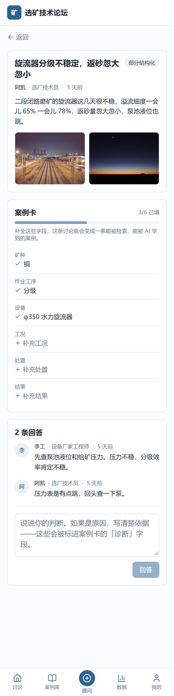

# 选矿技术论坛 · Mineral Processing Forum

[](https://github.com/sichengmu1-rgb/Mineral_Processing_Forum/actions/workflows/deploy-demo.yml)
[](https://www.gnu.org/licenses/agpl-3.0)
[](https://creativecommons.org/licenses/by-sa/4.0/)

**在线演示：<https://sichengmu1-rgb.github.io/Mineral_Processing_Forum/>**
（静态演示版，打开就能用，不用装任何东西）

把选矿现场的问题和一线经验，沉淀成结构化的、能公开复用的知识库。

<sub>A mineral-processing forum that turns field problems and frontline know-how into a
structured, openly reusable knowledge base.</sub>

---

## 为什么做这个

浮选是当今世界有色金属最主要的富集手段，全球约九成的铜、铅、锌、钼、锑、镍都靠它富集。
但这个行业和人工智能的结合明显落后于其他行业，卡住的地方不在算法，在数据。

一线经验其实一直在流动——微信群里，技术工、设备厂家、学生把现场问题连图带视频发出来，
有人认真答。问题是这些讨论**查不到、引不了、归不了类**，消息一冲就没了。
而已有的选矿论坛大多没人维护，因为纯论坛对提问者和回答者都没有回报。

所以这个论坛想做的事是：**保留那种真实的讨论，同时让它自动长成机器能用的数据。**

---

## 核心设计：提问零门槛，结构化后置

这里有一个绕不开的矛盾：

> 要求用户填一堆字段才能发帖，就没人发了；不填字段，产出的就只是一堆没法用的文本。

**解法是发帖时只要求两样东西——一两句话描述现象，加图或视频。**
其余所有字段（矿种、作业工序、设备、药剂制度、工况、处置、结果）都不在发帖时填，
而是发帖之后由系统提示、提问者回填、回答者补全，逐步长出来。

一句话：**发帖像发微信，沉淀像建档案。**

<p align="center">
  
</p>

界面上的体现是：缺失的字段不是空白，而是 `+ 补充工况` 这样的可点击入口。
用户看到的是"还差什么"，不是"要填一张表"。

### 状态机

```
已发布  →  部分结构化  →  已闭环 ★  →  已入库
（标题    （补了矿种/    （有处置、    （脱敏后汇进
 +现象）    工序/设备）    有结果）      知识库）
```

**「已闭环」是整个项目的北极星指标**，不是发帖数、也不是注册数。

一条只有提问和一堆猜测的帖子，训练价值很低；只有走到"**做了什么 → 结果怎样**"的案例，
才是文献里普遍缺失、模型真正学得到东西的那种数据。

---

## 三路数据，一个知识库

论坛只是其中一路输入。最终要合成的是**一份选矿领域的公开知识库**：

| 来源 | 是什么 | 状态 |
|---|---|---|
| **教材** | 权威选矿书籍，OCR、翻译、结构化、向量化 | 已完成 [Wills《矿物加工技术》第 8 版中译本](https://github.com/sichengmu1-rgb/Wills_Mineral_Processing_Technology)，23 个单元 |
| **论文** | 公开发表的浮选研究文献 | 待接入 |
| **现场** | 本论坛沉淀的一线问答案例 | 本项目 |

三者用同一种格式（`source_type` / `content` / `structured` / `provenance` / `evidence_level`）
存进同一个库，检索时不再区分来源。

### 证据等级

三个来源的可信度不一样，混在一起会出问题。所以每条片段入库时都带一个等级：

| 等级 | 来源 | 含义 |
|---|---|---|
| **A** | 教材、论文 | 经过同行检验或长期教学验证 |
| **B** | 已闭环案例 | 有实际处置、有结果反馈 |
| **C** | 未闭环讨论 | 只是推测，未有结论 |

AI 回答时必须标明依据来自哪一级、哪一条。教材上写的机理和某个矿上的一次尝试，
可靠程度不是一回事，不能混成一段话说出去。

### 这个库给谁用

- **现场工人**——可以像问同事一样直接问 AI："今天浮选泡沫突然变黏了，可能是什么原因？"
- **AI**——对选矿现场有了比通用大模型深得多的理解

**在论坛注册并参与过讨论的人，有资格使用这份公开数据集。**
这是本设计里最核心的激励机制：不是积分、不是徽章，而是**能用一个别人用不到的东西**。

---

## 快速开始

### 只想看看 → 打开在线演示

<https://sichengmu1-rgb.github.io/Mineral_Processing_Forum/>

静态演示版没有后端，数据存在浏览器内存里，刷新即重置。
但发帖、回答、补全案例卡都能正常操作——**把一条帖子补到「已闭环」，
就能在「数据」页看到它变成一条知识片段**，这是整个项目最想验证的一步。

### 跑完整版（前后端）

需要 **Node 18+** 和 **Python 3.10+**。

```bash
# 后端
cd backend
python -m venv .venv
./.venv/Scripts/python.exe -m pip install -r requirements.txt   # Windows
# source .venv/bin/activate && pip install -r requirements.txt  # macOS / Linux
./.venv/Scripts/python.exe app.py                                # 0.0.0.0:5000

# 前端（另开一个终端）
cd frontend
npm install
npm run dev                                                      # 0.0.0.0:5173
```

或直接双击 `start.bat`（Windows），它会自动建环境、装依赖、起服务，
并把手机访问地址打印出来。

**手机访问**：前后端都监听 `0.0.0.0`，同一 WiFi 下用手机打开 `http://<电脑IP>:5173` 即可。
前端只请求 `/api/*`，由 Vite 代理转发给 Flask，所以手机不需要单独访问 5000 端口。

### 构建静态演示版

```bash
cd frontend
VITE_DEMO=1 VITE_BASE=/Mineral_Processing_Forum/ npm run build
cp dist/index.html dist/404.html     # SPA 路由回退，缺了深链会打不开
```

---

## 技术栈

| | |
|---|---|
| 前端 | Vite 8 · React 19 · TypeScript · Tailwind v3 · shadcn/ui 风格组件 |
| 后端 | Flask 3 · SQLite（Python 标准库，无额外依赖） |
| 路由 | react-router-dom 7 |
| 部署 | GitHub Actions → GitHub Pages |

UI 组件按 shadcn/ui 的做法**直接放在源码里**（`frontend/src/components/ui/`），
不是 npm 依赖，改起来没有黑箱。

前端把数据访问抽象成 [`ForumApi`](frontend/src/lib/apiTypes.ts) 一个接口，两个实现：

- `remoteApi` —— 打 Flask 后端
- `localApi` —— 全在浏览器内存里跑（就是在线演示用的那个）

页面只依赖接口，不关心背后是哪一个。

---

## 项目结构

```
.
├── backend/
│   ├── app.py                # API 路由
│   ├── db.py                 # 建表 + 种子数据（8 条真实形态的现场问题）
│   └── requirements.txt
├── frontend/
│   └── src/
│       ├── components/ui/    # shadcn 风格基础组件
│       ├── components/       # Layout / PostCard / CaseCardPanel / FilterChips
│       ├── pages/            # 六个页面
│       └── lib/              # api / remoteApi / localApi / types
├── tools/
│   ├── shot.mjs              # 按设备尺寸截图（开发用）
│   └── console.mjs           # 抓浏览器控制台报错（开发用）
├── docs/screenshots/
├── .github/workflows/        # Pages 自动部署
└── start.bat
```

### 页面

| 路由 | 页面 |
|---|---|
| `/` | 讨论列表（搜索 + 矿种/工序/状态筛选 + 排序） |
| `/new` | 提问（只有标题、现象、传图三项） |
| `/posts/:id` | 帖子详情 + **案例卡补全区** |
| `/cases` | 案例库（只看已闭环案例） |
| `/stats` | 数据看板 + 「论坛数据 → 知识库片段」导出预览 |
| `/me` | 我的提问、贡献、数据集使用资格 |

### API

| 方法 | 路径 | 说明 |
|---|---|---|
| GET | `/api/meta` | 筛选项、当前用户 |
| GET | `/api/stats` | 指标 |
| GET | `/api/posts` | 列表，支持 `q` `ore_type` `process` `status` `sort` |
| GET | `/api/posts/:id` | 详情（含字段补全记录） |
| POST | `/api/posts` | 发帖（只需 `title` + `phenomenon`） |
| POST | `/api/posts/:id/replies` | 回答 |
| PATCH | `/api/posts/:id/card` | **补全案例卡**，状态机在此推进 |
| GET | `/api/export/preview` | 预览导出的知识片段格式 |

---

## 这个 Demo 还没做的

视频上传、登录认证、贡献积分、脱敏审查后台、GitHub 数据同步、语义检索、
通知系统、问答 Agent。

数据表已经留了 `field_logs`（字段补全留痕）和 `evidence_level`（A/B/C 证据等级）
的位置，接这些功能不用改结构。

---

## 开发备注

几个踩过的坑，留在这里省得下次再踩：

**不要用 `chrome --screenshot --window-size=390,844` 截手机图。**
Windows 下 headless Chrome 有约 500px 的最小窗口宽度，指定 390 实际仍按 497 渲染，
截出来右边被裁掉——看起来像横向溢出，其实页面 `scrollWidth == clientWidth`，没有溢出。
要真按手机宽度渲染得走 CDP，用 `tools/shot.mjs`：

```bash
chrome --headless=new --remote-debugging-port=9222 about:blank &
node tools/shot.mjs http://localhost:5173/ shot.png 390 844 1
```

**GitHub Pages 子路径有两个必踩的坑**，两个都表现为白屏或深链打不开：

1. 资源路径要设 `base`，否则 404 —— 构建时传 `VITE_BASE=/Mineral_Processing_Forum/`
2. React Router 要设 `basename`，否则报 `No routes matched` —— 见 `src/App.tsx`

**Git Bash 会改写看起来像 Unix 路径的环境变量。** `VITE_BASE=/xxx/` 传进去会变成
`C:/Program Files/Git/xxx/`，直接写进产物。本地构建加 `MSYS_NO_PATHCONV=1`。

**Windows 上 `.bat` 要存成 GBK。** cmd 按 ANSI 代码页读批处理文件，
用 UTF-8 存中文会导致解析错位、整批命令报错。

**种子数据**在 `backend/db.py` 的 `seed()`，只在库为空时写入。
想重来一遍就删掉 `backend/forum.db` 再启动。
`frontend/src/lib/seed.json` 是从数据库导出的副本，供静态演示版使用，两处要一起改。

---

## 相关

- [Wills 矿物加工技术中文译本](https://github.com/sichengmu1-rgb/Wills_Mineral_Processing_Technology)
  —— 同一份知识库的教材来源，23 个单元

## 许可

本项目采用双许可。

**代码**：[GNU AGPL-3.0](LICENSE)。可以商用、修改、分发；如果修改后的版本作为网络服务提供给他人，必须公开对应源码。

**数据**：[CC BY-SA 4.0](DATA_LICENSE)。可以复制、分发、改编；需署名，并以相同许可共享衍生作品。

引用格式见 [CITATION.cff](CITATION.cff)，版权声明见 [NOTICE](NOTICE)。

不用 MIT 的原因：MIT 和 CC BY 允许任何人把成果闭源拿走，与这个项目想解决的问题相反。AGPL 与 CC BY-SA 都不限制商业使用，只要求衍生作品保持开放。

---

## English

A forum for the mineral-processing industry that turns field problems and frontline
experience into a structured, openly reusable knowledge base.

The core design is **zero-friction posting, deferred structuring**: a post needs only a
title, a description of the symptom, and a photo. Everything else — ore type, circuit,
equipment, operating conditions, diagnosis, action taken, outcome — is filled in
afterwards by the asker, the community, and automated prompts.

A thread is only considered a **closed case** once it records both an action and its
outcome. That is the project's north star metric, because those are the records a model
can actually learn from — and the ones that can answer a worker's real question:
*"so what should I do?"*

Closed cases are desensitised and exported as knowledge chunks alongside textbook and
paper sources, each tagged with an evidence level (A: textbook/paper, B: closed case,
C: open discussion). Anyone who has registered and taken part in the forum may use the
resulting open dataset.

## License

Code is licensed under the [GNU AGPL-3.0](LICENSE); the dataset is licensed under
[CC BY-SA 4.0](DATA_LICENSE). Both permit commercial use, but require derivative works
to remain open. See [CITATION.cff](CITATION.cff) for citation.
